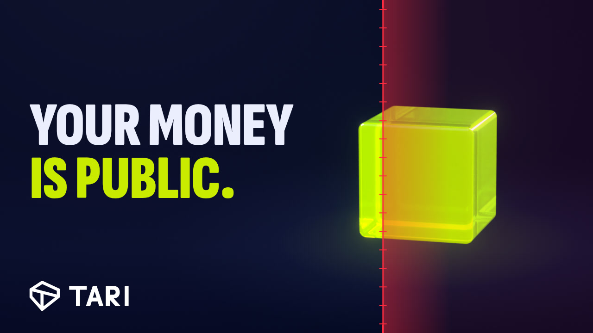
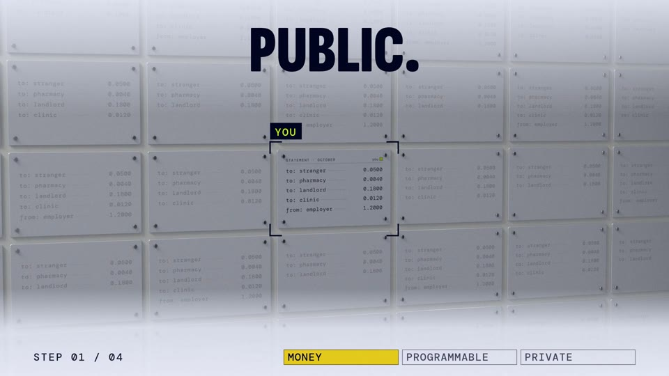
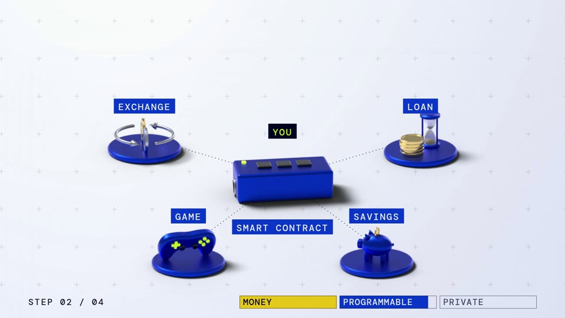
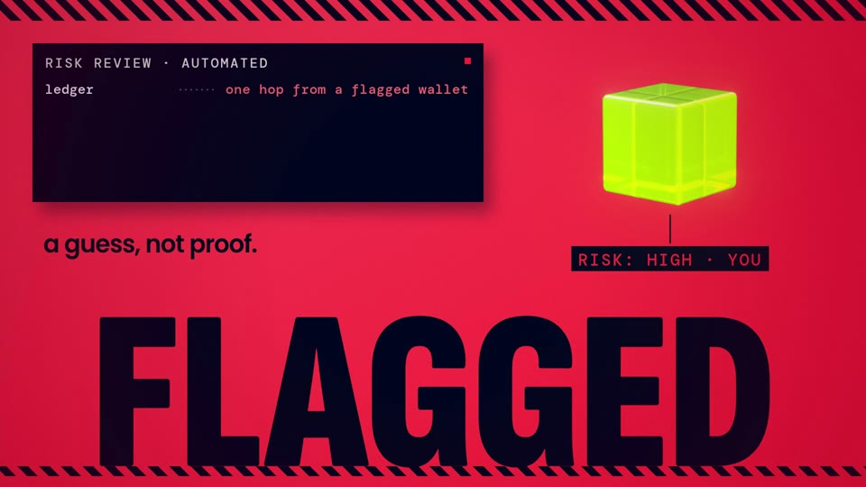
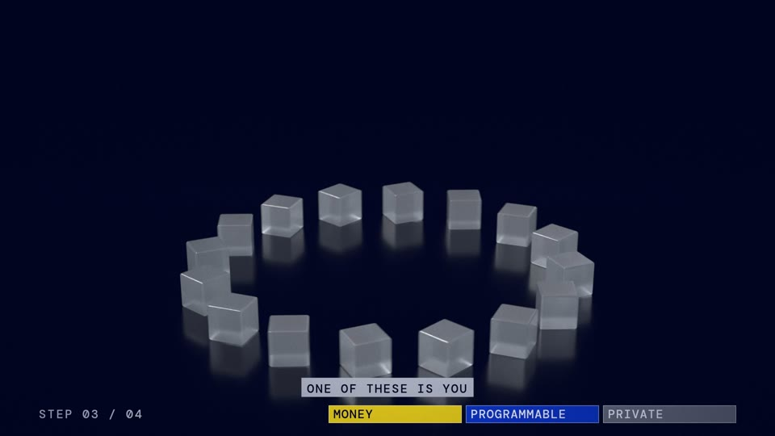
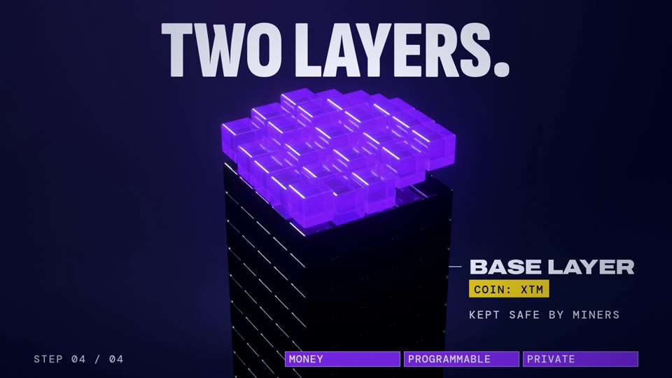
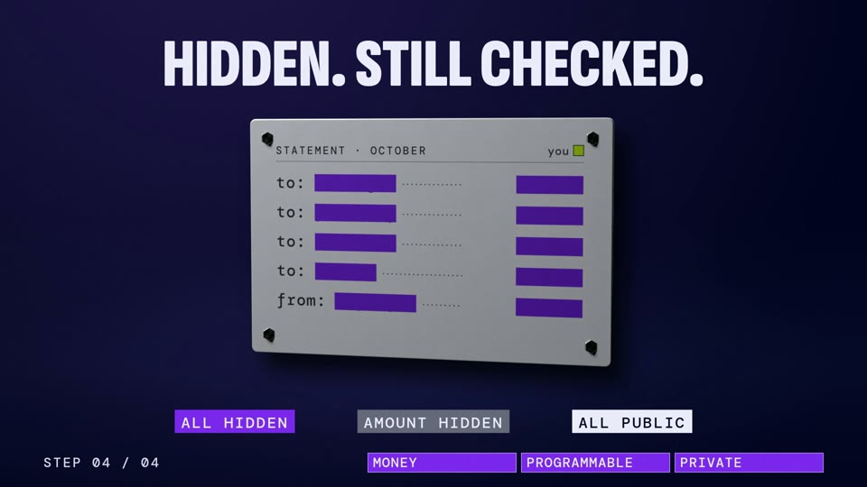

# The Fourth Step

<a href="https://youtu.be/5GJJaFRKPdQ"></a>

### [▶ Watch it on YouTube](https://youtu.be/5GJJaFRKPdQ)

What is Tari? Private smart contracts, explained simply, in 5:44.

The Shorts: [The board](https://youtube.com/shorts/rqCP3UcyPQY) · [Flagged](https://youtube.com/shorts/DKEJ6yKHpQI) · [Money with no memory](https://youtube.com/shorts/xkmAZZTRg_Y)

---

No video editor. Every frame is drawn in JavaScript, the 3D objects are Blender scenes built from Python, and the cuts land on the words of the voice. Everything that made it is here: the code, the script, the voice, the music, the sound effects and the Tari logos.

<p>
  
  
  
  
  
  
</p>

## Make it yourself

You need Node 20+, ffmpeg and Chrome. Blender only for the 3D.

```
npm install
node render.mjs --page film.html --out out/the-fourth-step.mp4

node audio/music-track.mjs --piece long --track audio/tracks/pulso-suave.m4a
node audio/sfx-v4.mjs --piece long
node audio/mix-v4.mjs --piece long
node audio/mux.mjs --video out/the-fourth-step.mp4 --audio out/audio/long/mix.wav --out out/the-fourth-step-final.mp4
```

For the Shorts, render `s1.html`, `s2.html` or `s3.html` with `--vertical`, and use `--piece s1` (`s2`, `s3`) for the sound.

The 3D renders are about 14 GB, too big for git, so a fresh clone draws flat 2D stand-ins. `bash blender/render-all.sh` rebuilds the real ones (hours on a GPU).

## What's where

- `acts/` and `shorts.js`: the scenes
- `script/` and `captions/`: the words
- `audio/`: the voice, the music, the sound effects and the mix
- `blender/`: the 3D
- `brand/`: the Tari logos

## Inspiration

- [Civilization](https://x.com/CarsonGragg/status/2103245240169808005) by Carson Gragg: the look
- Bungie's [Marathon](https://80.lv/articles/marathon-art-director-shares-the-team-s-creative-influences) and its "graphic realism": the 3D objects
- Apple's [Liquid Glass](https://developer.apple.com/videos/play/wwdc2025/219/): the glass
- Tari's brand kit: the colors and the tower
- [What is Bitcoin?](https://www.youtube.com/watch?v=Um63OQz3bjo) by WeUseCoins and [But how does bitcoin actually work?](https://www.youtube.com/watch?v=bBC-nXj3Ng4) by 3Blue1Brown: how to explain it
- [Monero: Ring Confidential Transactions](https://www.youtube.com/watch?v=M3AHp9KgTkQ): the presentation
- [Monero Means Money](https://www.youtube.com/watch?v=8quGD9W7B2I), Dr. Daniel Kim at 36C3, and [Talking Monero and Privacy with Riccardo Spagni](https://www.youtube.com/watch?v=TATpQ7KogBc): the arguments and the quotes

Fork it, change it, make your own version.
